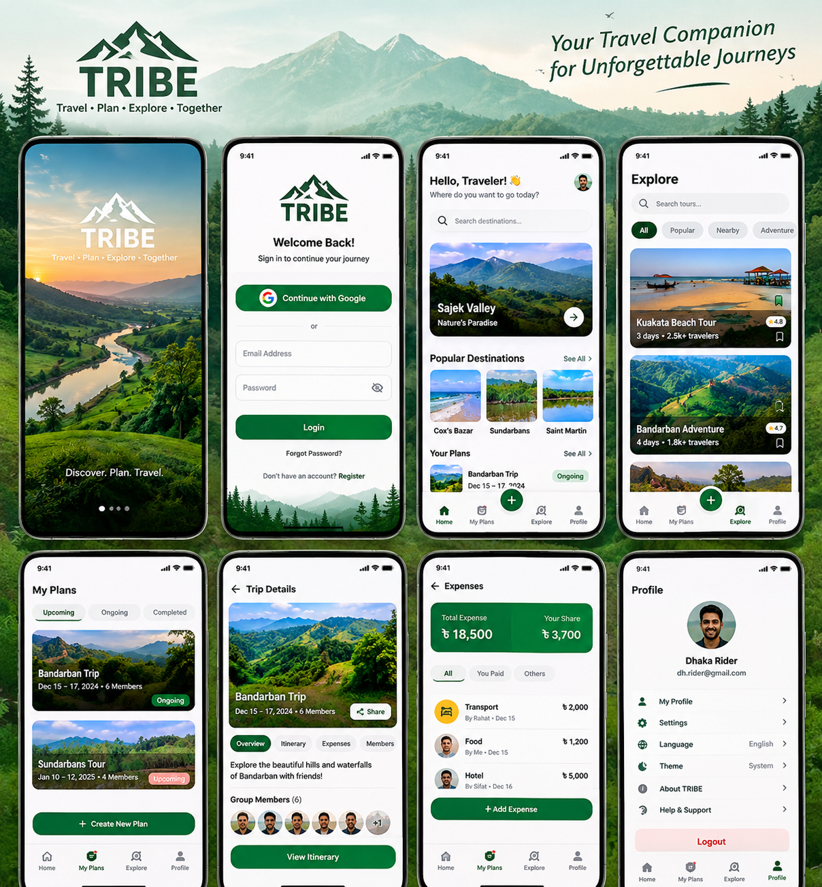

# 🌲 TRIBE — Modern Travel Planning & Group Management

<p align="center">
  
</p>

<p align="center">
  <a href="apk/TRIBE-v1.0-debug.apk">
    
  </a>
  
  
  
  
  
</p>

---

## 📖 About TRIBE

**TRIBE** is a modern, high-end native Android travel planning and group trip management application built from scratch with **Kotlin**, **Jetpack Compose**, and **Material Design 3**.

Designed initially with Bangladesh’s premier destinations in mind (and architected for international expansion), TRIBE empowers travelers to discover scenic locations, build custom itineraries, organize trips with friends, manage group checklists, and split travel expenses with exact decimal precision.

---

## 📥 Download & Install APK

You can download and install the pre-built application APK directly:

- **Direct Repository Download:** [👉 `apk/TRIBE-v1.0-debug.apk`](apk/TRIBE-v1.0-debug.apk)
- **File Size:** ~32 MB
- **Minimum Android Version:** Android 7.0+ (API Level 24)
- **Target Android Version:** Android 15 (API Level 36)

### How to Install:
1. Download **`TRIBE-v1.0-debug.apk`** to your Android phone.
2. Open the downloaded file in your browser or Files app.
3. If prompted, allow *"Install unknown apps"* for your browser or file manager.
4. Tap **Install** and launch **TRIBE**!

---

## ✨ Key Features

### 🌄 1. Destination Discovery & Exploration
- Browse popular destinations: **Sajek Valley**, **Bandarban**, **Sundarbans**, **Kuakata**, **Saint Martin**, and **Cox's Bazar**.
- Category filtering: Popular, Nearby, Adventure, Beach, and Hills.
- High-resolution hero imagery, duration badges, ratings, and one-tap bookmarking/saving.

### 🎒 2. Group Trip & Tour Management
- Organize and track trips across **Upcoming**, **Ongoing**, and **Completed** states.
- Modal bottom sheet to create new trips with destination, date pickers, budget, and visibility toggles.
- Member management with invite links and group member avatars.

### 🗺️ 3. Detailed Day-by-Day Itineraries
- Interactive schedule timeline organized by day and timestamp.
- Add activity plans with custom titles, locations, and time slots.

### 💰 4. Group Expense Splitting & Settlements
- Financial arithmetic powered by **`java.math.BigDecimal`** to eliminate floating-point rounding errors.
- Categorized expense logging (Transport, Food, Hotel, Sightseeing).
- Instant calculation of:
  - **Total Group Expense**
  - **Your Share**
  - **Your Total Paid**
  - **Net Balance** (Owed vs. To Receive)
- Peer-to-peer settlement tracking (*Settle Up*).

### 🔐 5. Dual-Phase Google Credential Manager Sign-In
- Integrated with **Android Jetpack Credential Manager** (`GetGoogleIdOption`).
- **Resilient Two-Phase Auth**:
  1. *Phase 1*: Attempts silent sign-in with `setFilterByAuthorizedAccounts(true)`.
  2. *Phase 2 (Fallback)*: If `NoCredentialException` occurs, automatically retries with `setFilterByAuthorizedAccounts(false)` so new users can select any Google account on their device.
- Cryptographically secure 32-byte nonces hashed with SHA-256 for replay attack prevention.
- Authenticates through **Supabase Google OAuth** flow.
- Also includes Email/Password registration, password recovery, and instant Guest Mode.

### 🗄️ 6. Offline Persistence with Room Database
- Local SQLite caching using Android Jetpack **Room** (`TripDatabase`, `TripEntity`, `TripDao`).
- Enables creating and viewing trips even when offline or with intermittent connectivity.

### 🌐 7. Dual-Language Support (English & বাংলা)
- Native in-app language switcher for **English** and **Bengali (বাংলা)**.
- Dedicated resource qualifiers (`values/strings.xml` and `values-bn/strings.xml`).

### 🌓 8. Nature-Inspired Material Design 3 Theming
- Custom forest-green palette inspired by mountains, hills, and rivers.
- Full support for **Light**, **Dark**, and **System** theme modes.
- Complete edge-to-edge support with safe `WindowInsets` handling.

---

## 🏗️ Architecture & Project Structure

TRIBE follows modern Android Architecture (**Clean Architecture + MVVM**):

```
app/src/main/java/com/example/
├── MainActivity.kt               # Single Activity entry point with Edge-to-Edge & Navigation
├── core/
│   ├── database/                 # Room database (TripDatabase, TripEntity, TripDao)
│   ├── designsystem/             # Material 3 design tokens, components, bottom bar
│   ├── network/                  # Supabase Retrofit client & API definitions
│   ├── preferences/              # DataStore for Theme & Language preferences
│   └── security/                 # GoogleAuthHelper (Credential Manager) & SessionManager
├── data/
│   ├── remote/dto/               # Moshi JSON DTOs for Supabase endpoints
│   └── repository/               # SupabaseAuthRepository & DefaultTravelRepository
├── domain/
│   └── model/                    # Domain models (Tour, Destination, Expense, ExpenseSummary)
├── feature/
│   ├── auth/                     # Welcome, Login, and Registration screens
│   ├── explore/                  # Discover and search destinations screen
│   ├── home/                     # Home dashboard with greetings and user plans
│   ├── notifications/            # Notification center
│   ├── plans/                    # My Plans screen and CreatePlan bottom sheet
│   ├── profile/                  # User profile, theme settings, language toggle
│   └── tourdetails/              # Detailed trip screen (Overview, Itinerary, Expenses, Checklist)
└── ui/
    ├── MainViewModel.kt          # Unified state management with StateFlow
    └── theme/                    # ColorScheme, Typography, and Theme definition
```

---

## 🛠️ Tech Stack & Dependencies

- **Language:** Kotlin 2.0.21
- **UI Toolkit:** Jetpack Compose & Material 3 (1.3.1)
- **Architecture:** MVVM + Clean Architecture + Repository Pattern
- **Async Concurrency:** Kotlin Coroutines & Kotlin Flow (`StateFlow`, `collectAsStateWithLifecycle`)
- **Networking:** Retrofit 2.11.0, OkHttp 4.12.0, Moshi 1.15.2
- **Authentication:** Android Credential Manager 1.5.0, Google Identity 1.1.1, Supabase Auth
- **Local Persistence:** Room Database 2.6.1 + KSP
- **Local Preferences:** AndroidX DataStore 1.1.2
- **Image Loading:** Coil 2.7.0
- **Testing:** JUnit 4, Robolectric 4.14.1, Coroutines Test

---

## 🚀 Building from Source

### Prerequisites
- Android Studio Ladybug | 2024.2.1+ or newer
- JDK 17
- Android SDK Platform 34 or 36

### Build Steps:
1. Clone this repository:
   ```bash
   git clone https://github.com/YOUR_USERNAME/tribe-android-travel-app.git
   cd tribe-android-travel-app
   ```
2. Configure environment credentials:
   ```bash
   cp .env.example .env
   ```
   *(Optional: Add your custom `SUPABASE_URL`, `SUPABASE_ANON_KEY`, and `GOOGLE_WEB_CLIENT_ID` in `.env`)*
3. Run unit and Robolectric tests:
   ```bash
   gradle :app:testDebugUnitTest
   ```
4. Build the Debug APK:
   ```bash
   gradle :app:assembleDebug
   ```
   The generated APK will be at:
   `app/build/outputs/apk/debug/app-debug.apk`

---

## 🔄 CI/CD Automation

This repository includes automated **GitHub Actions** workflows:
- **`.github/workflows/android.yml`**: Runs tests and builds the debug APK on every push or pull request to `main`.
- **`.github/workflows/release.yml`**: Automatically publishes a GitHub Release with the APK attached whenever a new Git tag (e.g. `v1.0.0`) is pushed.

---

## 📄 License

This project is open source and available under the [MIT License](LICENSE).
